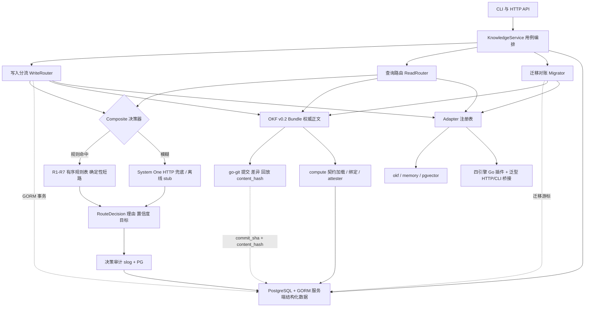

# 架构设计

## 分层

包依赖单向：`okf` / `meta` / `config`（L0，零内部依赖）→ `vcs` / `adapter` / `bridges` → `plugins`（清单 + 引擎包）→ `router` / `eval` / `compute` → `service` → `handlers` / `cli` → `cmd/agentmem`。端口定义在消费方，实现注入。`gorm` 只在 `internal/meta` 内出现；`compute.SQLExecutor` 定义在 `meta`，其 GORM 实现留在 `internal/meta/postgres_exec.go`，避免下层反向 import。

`config` 包不引入第三方 dotenv 依赖：`.env` 由标准库解析。加载顺序为 `Default()` → `.env`（`--env` / `AGENTMEM_ENV_FILE` 指定路径）→ 进程环境变量 → `Validate()`。封闭的 `AGENTMEM_*` 键白名单让未知键、非法数值、非法 `AGENTMEM_ADAPTERS` JSON 全部 fail closed；`POSTGRES_*` 等非前缀键留给 Docker Compose。`.env` 不进镜像，Compose 用 `env_file` 与 `${...}` 插值读取同一文件。

## 计算数据流

1. `POST /v1/computations` / CLI `compute` 进入 `compute.Service.Run`。
2. `LoadContract` 从 OKF+Git 读取受批准计算体（`.sql` 资源或正文内联块），计算 `contract_hash`。
3. `Bind` 只接受声明参数值，`:name` 转为 `$N` 并生成 `params_digest`；任何计算体改写被拒。
4. `RuntimeRegistry` 选择 runtime；仅 `postgres` 通过 `meta.SQLExecutor` 只读参数化执行，其余返回 `Unsupported`。
5. executor 产出 `Receipt`；确定性 Go `Attester` 校验 SQL provenance 与展示值 fidelity。
6. 成功才返回 `display_value`；失败一律 `display_allowed=false`，并把 verdict 写入 `computation_runs`。详见 [computations.md](computations.md)。

## 写入数据流

1. `WriteRouter.Put` 补齐 ACL 扩展字段，抽取特征（类型、体量、结构化度、权威/敏感、是否已有权威概念）。
2. `Composite` 先裁剪 eligible 集合，再按 `R1`–`R7` 顺序短路；仅模糊样本走 System One。
3. 审计决策（`slog` + PostgreSQL `decisions` 表）。
4. 若目标含 `okf`：`OKFStore.Put` 先写正文（原子写 + 增量 `index.md` + `log.md`），`go-git` 单次提交，再以 GORM 事务/upsert 记录 `content_hash` + `commit_sha` + ACL。
5. 对每个 RAG 目标执行幂等投影并记录 `projections` 状态与 embedding 指纹。
6. 投影失败**不回滚**正文，记为 `failed`，由迁移补偿。
7. 若目标不含 `okf`（projection-only）：只写 RAG 与元数据（`status=projection-only`），Git 不产生正文。

## 读取数据流

1. `ReadRouter.Query` 按查询形态分类（definition / exploratory / aggregate / general）并路由。
2. 选中的通道在 `context.WithTimeout` 下**并发**执行，总延迟取 max 而非 sum；错误按通道记录，不静默吞掉。
3. `mergeHits` 按 ConceptID 去重，canonical 通道优先；同一概念在外部通道出现不同摘要时记录 `Conflict`，不覆盖。
4. 结果经 `MetaStore.CheckACL` 过滤后返回，保留 `Source` 与 `Citation`。

## 迁移数据流

- `canonical_to_rag`：按 `content_hash` 与 `Fingerprint` 对账，缺失/漂移的投影重建。
- `rag_to_canonical`：从投影侧审计，孤儿（无正文）删除并标记 `stale`，漂移标记待重建。
- 游标写入 `migration_cursors`，支持 `dry-run`、`limit` 分批与断点续跑；`dry-run` 不写投影也不推进游标。

## 评测口径（重要）

参考项目口径不一致，本实现显式区分：

| 指标 | 定义 | 对齐 |
|---|---|---|
| `Recall@k` | 覆盖率 \\(\|top-k \cap relevant\| / \|relevant\|\\) | DeepTutor `kb eval`、track_a 报表 |
| `HitRate@k` | 二值：top-k 是否出现任一相关文档 | `memo/benches` |

另外提供 `Precision@k`、`nDCG@k`（二值增益）、`MRR`、`MAP`，全部为纯函数，无 LLM 裁判。路由侧提供 `EvaluateRouting`（目标集合精确匹配 / precision / recall）。

## 性能与边界

- OKF Put/Get 按 Concept ID 直接定位文件，O(1)；`index.md` 只重生成受影响目录。
- 元数据查询走 `content_hash` / `concept_id` / `projection_status` 索引；批量写入使用 GORM 事务 + `clause.OnConflict`。
- 规则判定 O(规则数)，System One 缓存命中 O(1)。
- 内存适配器检索 O(N·d)，仅为小规模基线；大数据量引导到 pgvector HNSW。
- 双写窗口由「主干先提交 + 投影幂等 + 迁移对账」收敛，不引入分布式事务。
