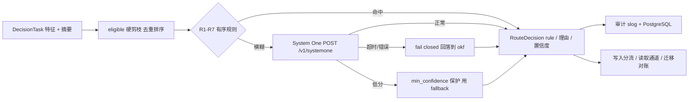

# 智能路由与 System One

## 两级决策



规则始终先于 System One 执行，概率选择**不能**覆盖权威性判定。`sanitizeDecision` 会把目标裁剪到 eligible 池内，并保证 `okf` 在目标集合中排首位（冲突时 OKF 优先）。

## 规则表

| ID | 条件 | 目标 | 理由 |
|---|---|---|---|
| R1 | 写 + 权威类型/人工验证/Attested | `okf` | 权威定义属于可审计主干 |
| R2 | 写 + 敏感或 private | `okf` | 不投影到第三方 RAG |
| R3 | 读 + definition/exact/official 查询 | `okf` | 精确答案必须可审计 |
| R4 | 写 + 已存在权威概念 | `okf` + 首个 RAG | 更新时刷新主投影 |
| R5 | 写 + 大文档（≥4096B） | `okf` + 全部 RAG | 长尾检索需要投影 |
| R6 | 读 + exploratory | 全部 RAG | 探索性查询靠概率召回 |
| R7 | 读 + aggregate | `okf` + 全部 RAG | 权威事实 + 长尾证据 |

未命中任何规则即视为模糊样本，进入 System One。

## 特征（不发送正文）

`Features`：`ByteSize`、`Structured`、`Authoritative`、`Sensitive`、`Verified`、`HasCanonical`、`Type`、`Status`、`QueryKind`。写入侧 `Digest(doc)` 只取 type/title/description 的前 200 字符；System One 请求的 `state` 只含这些标量与候选集描述，不含正文、凭据或 PII。

查询形态分类：`definition` / `exploratory` / `aggregate` / `general`。

## System One 契约（对齐 `router/afm_d`）

请求：

```json
{
  "state": "kind=read;query_kind=general;bytes=12;authoritative=false;...",
  "questions": {
    "route": {
      "type": "choice",
      "instructions": "Choose exactly one eligible target...",
      "criteria": {"okf": "...", "memory": "..."}
    }
  }
}
```

响应（兼容两种形状）：

```json
{"answers": {"route": {"choice": "memory", "confidence": 0.91, "reason": "..."}}}
```

| 参数 | 值 | 说明 |
|---|---|---|
| `timeout_ms` | 5000 | 超时不走 fallback，由上层 fail closed |
| `cache_capacity` | 256 | FIFO；键为 `normalize(text) × kind × sorted(eligible)` |
| 缓存命中置信度 | 0.5 | `reason` 带 `cache:` 前缀，`source=cache` |
| `max_choices` | 255 | 候选集上限 |
| `min_confidence` | 0.5 | 低分走 fallback（须在 eligible 池内） |
| `fallback` | `okf` | 低分保护目标 |
| `fail_closed` | true | 错误/超时/非法 choice → 回落到 `okf` |

`endpoint` 为空时使用离线确定性 `StubDecisioner`，CI 不需要网络。

## 写入分流

1. 主干先提交（Git），生成 `content_hash` 与 `commit_sha`。
2. GORM 事务写 `concepts_meta`。
3. 按目标幂等投影到 RAG，记录 `projections`（含 `Fingerprint`）。
4. 投影失败不回滚正文，记 `failed` 由迁移补偿。
5. 决策与投影结果写入审计。

`projection-only` 模式：决策目标不含 `okf` 时，只写 RAG 与元数据（`status=projection-only`），适用于可重建、低价值的原始材料；此时 Git 无正文。

## 读取合并

- 单路 / 双路并发，`context.WithTimeout` 控制总延迟（取 max 而非 sum）。
- 按 `ConceptID` 去重，canonical 命中优先；外部通道摘要不同则生成 `Conflict` 记录，不静默覆盖。
- `MetaStore.CheckACL` 过滤结果。
- 通道错误写入 `Errors` 映射，可见不吞。

## 迁移

- `canonical_to_rag`：以 `content_hash` + `Fingerprint` 对账，缺失/漂移则重建投影。
- `rag_to_canonical`：审计投影侧，孤儿删除并标记 `stale`，漂移标记待重建。
- `dry_run` 只出计划；`limit` 分批；`migration_cursors` 保存 `last_concept_id` 与 `done`。

## 审计

`Evidence.Record` 用 `slog` 输出 `kind / concept_id / rule_id / source / confidence / targets`，并写入 PostgreSQL `decisions` 表。`GET /v1/decisions` 或 `agentmem decisions` 可回放。日志与审计均不含正文、PII、凭据或完整 DSN。
